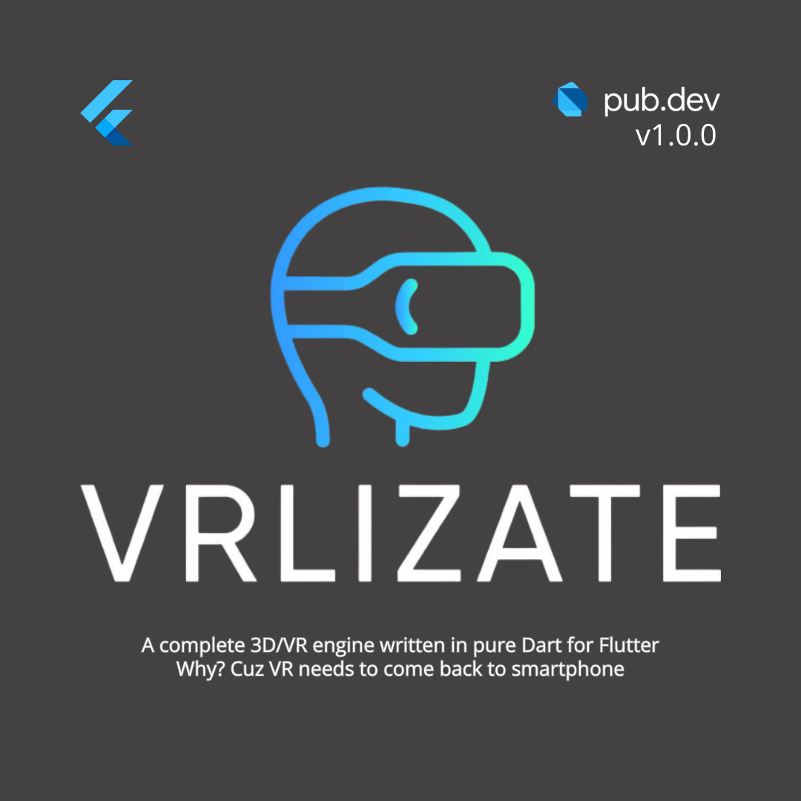

<p align="center">
  
</p>

# vrlizate

Motor 3D/VR Open Source escrito en Dart para crear experiencias inmersivas en smartphones y aplicaciones Flutter.

> Versión actual: **1.13.0**. Consulta [CHANGELOG.md](CHANGELOG.md) para las notas de versión y [ARCHITECTURE.md](ARCHITECTURE.md) para el detalle arquitectónico.

## Responsabilidades principales

- **Ciclo de vida de sesiones (`VrSessionHost` / `VrSessionController`):** serializa inicio, pausa, reanudación y cierre al cambiar de ruta o pasar al fondo, sin depender de SINT ni `neom_vr`.
- **Grafo de escena y renderizado Dart/Canvas (`VrlizateScene`):** meshes 3D, materiales PBR, luces, niebla, UI espacial, culling y perfiles de calidad (`lite`, `standard`, `high`) con oclusión híbrida por rayos CPU acotados (`hybridObjectSpace`).
- **Entrada unificada (`VrInputArbiter` / `VrSpatialInputState`):** prioridad `remotePhone/touch > periféricos > gaze`, pool fijo de eventos, supresión de dwell tras interacción activa y giro en borde de stick (`VrStickEdgeTurn`).
- **Mando remoto 3DoF (`VrRemoteControllerSession` / `VrLocalSocketTransport`):** protocolo autenticado padre/hijo, estimación de brazo acotada (`VrControllerArmModel`) y predicción de pose (`VrRemotePosePredictor`).
- **Física delegada (`vrlizate_physics`):** adaptadores de escena para `RigidBody` y `PhysicsWorld`.

## Instalación

```yaml
dependencies:
  vrlizate: ^1.13.0
```

Para renderizado estereoscópico sobre Flutter GPU utiliza el paquete complementario [`vrlizate_scene`](../vrlizate_scene/README.md) y los controles de [`vrlizate_widgets`](../vrlizate_widgets/README.md).

## Ejemplo rápido

```dart
import 'dart:ui';
import 'package:vector_math/vector_math.dart';
import 'package:vrlizate/vrlizate.dart';

final engine = VREngine(
  scene: VrlizateScene(
    quality: VrlizateSceneQuality.standard,
    rayTracingMode: VrlizateRayTracingMode.hybridObjectSpace,
  ),
);

void createExperience() {
  engine.cameraRig.position = Vector3(0, 1.6, 3);
  engine.scene.add(
    LitMeshNode(
      name: 'welcome-cube',
      geometry: CubeGeometry(size: 1),
      material: PBRMaterial(color: const Color(0xFF2E90FA)),
    ),
  );
  engine.enableHeadTracking();
  engine.enableGazePointer(dwellDuration: 1.5);
  engine.start();
}
```

## Estructura del paquete

```text
lib/
├── core/          Cámara, motor, árbitro de entrada, matemáticas y red
├── session/       VrSessionHost, VrSessionController y adaptadores de ciclo de vida
├── scene/         Grafo de escena, geometrías, materiales, luces y texturas
├── interaction/   Raycast, selección por mirada y locomoción
├── spatial_ui/    Paneles, texto y botones espaciales
├── animation/     Clips, esqueletos, keyframes y skinning
├── physics/       Adaptadores hacia vrlizate_physics
├── effects/       Distorsión, niebla, bloom, SSAO y viñeta
├── loaders/       Carga de glTF/GLB
└── xr/            Contratos e integraciones XR
```

## Verificación

```bash
flutter pub get
flutter analyze
flutter test
```

## Licencia

Apache License 2.0. Consulta [LICENSE](LICENSE) y [CONTRIBUTING.md](CONTRIBUTING.md).
